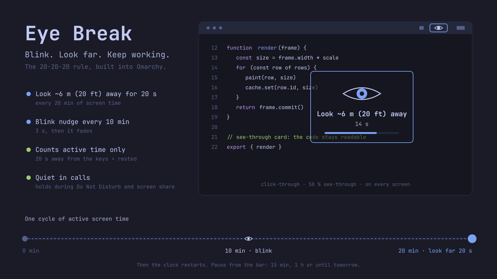

# Eye Break

[](https://github.com/a-b/omarchy-eyebreak/actions/workflows/ci.yml)



Blink nudges and 20-20-20 look-far breaks for the Omarchy bar. Reminders are small see-through cards on every screen. They count active screen time only, wait while you are in Do Not Disturb or sharing your screen, and are set up from a menu on the bar.

## Requirements

- Omarchy 4.5 or newer (the Quickshell desktop and its plugin system).
- For screen-share detection: Hyprland's desktop portal (`xdg-desktop-portal-hyprland`), which Omarchy ships.

Tested on Omarchy 4.5.0rc1 with Hyprland 0.56.2 and Quickshell 0.3.2, with two monitors.

## Install

```bash
omarchy plugin add https://github.com/a-b/omarchy-eyebreak.git --enable
```

This installs it at `~/.config/omarchy/plugins/a-b.eyebreak` and puts the eye icon in the right section of the bar. Move it with, for example, `omarchy bar move a-b.eyebreak --section center`.

`omarchy plugin add` may print "omarchy-shell is not responding" while the shell loads the plugin. It is harmless: the plugin is still enabled.

## What it does

| Reminder | Default | What you see |
|---|---|---|
| Blink nudge | every 10 min of active use | A small card with a blinking eye for 3 s |
| Look-far break | every 20 min of active use | "Look ~6 m (20 ft) away" with a 20 s countdown |

- **Active time only.** 20 s without keyboard or mouse input counts as a rest and restarts both clocks. Apps that keep the screen awake (a playing video, a call) keep you counted as present. Suspend also counts as a rest.
- **Quiet when it should be.** While notifications are in Do Not Disturb, or while a screen share is running, a due blink nudge is skipped and a due look-far break waits. The break shows once DND or the share ends; DND is re-checked once a minute.
- **On every screen, out of the way.** Each card lands at a random spot near the middle of each screen, above fullscreen apps. Cards never take keyboard focus and are click-through unless you turn on click to dismiss.
- **Matches your theme.** Cards, the menu and the bar icon use the current Omarchy theme colours, light or dark, and change with it when you switch themes.

## Bar menu

Hover the eye for the time to the next reminders, e.g. "Look far in 19 min · blink in 9 min" (a reminder that is off is left out). The menu shows the same line at the top. Click the eye for:

- Pause 15 min, 1 h or until tomorrow (06:00), and Resume. While paused the eye is shut.
- Take a look-far break now.
- Sliders for the blink and look-far intervals. The leftmost position turns that reminder off. The recommended value is shown at the right of each.
- Background slider: how opaque the card background is (20–100 %). The eye, text and border always stay solid.
- Click to dismiss: clicking a card closes it on every screen.
- Coloured border: turns the accent-coloured border around the cards on or off.

## Settings

All settings live in the widget's entry in `~/.config/omarchy/shell.json`. The menu sets most of them; set the rest with `omarchy bar set a-b.eyebreak <key> <value>`.

| Key | Default | Range |
|---|---|---|
| `blinkEnabled` | `true` | |
| `blinkEveryMinutes` | `10` | 1–60 |
| `blinkSeconds` | `3` | 1–10 |
| `farEnabled` | `true` | |
| `farEveryMinutes` | `20` | 1–120 |
| `farSeconds` | `20` | 5–120 |
| `opacityPercent` | `50` | 20–100; card background only |
| `dismissOnClick` | `false` | |
| `showBorder` | `true` | accent-coloured border around the cards |

Booleans need `--json`, e.g. `omarchy bar set a-b.eyebreak dismissOnClick true --json`.

## Run from a terminal

```bash
omarchy-shell a-b.eyebreak status          # JSON: seconds to each reminder, pause, idle, sharing, last outcome
omarchy-shell a-b.eyebreak pause 30        # minutes, or "tomorrow"
omarchy-shell a-b.eyebreak resume
omarchy-shell a-b.eyebreak breakNow
omarchy-shell a-b.eyebreak blinkNow
omarchy-shell a-b.eyebreak dismiss
```

## Why these numbers

| Source | Guidance |
|---|---|
| American Optometric Association, [Computer vision syndrome](https://www.aoa.org/healthy-eyes/eye-and-vision-conditions/computer-vision-syndrome) | 20-20-20 rule: every 20 min, look about 20 ft (6 m) away for 20 s. Blink often to keep the eye surface moist. |
| CDC/NIOSH, Galinsky et al. [2000](https://stacks.cdc.gov/view/cdc/198356), [2007](https://pubmed.ncbi.nlm.nih.gov/17514726) | Short extra breaks lower eyestrain and discomfort without hurting productivity. |
| American Academy of Ophthalmology, [blue light](https://www.aao.org/blue-light) | Screen discomfort comes from overuse and blinking less, not from blue light, so Eye Break does nothing about blue light. |

The 10-minute blink interval is this plugin's choice, not a published guideline. This is not medical advice; see an eye doctor about persistent symptoms.

## Known limits

- A pause is forgotten when the shell restarts.
- The time in the menu and tooltip moves in 5 s steps while you are active. It holds still while you are idle, because idle time does not count.
- "Until tomorrow" always ends at 06:00.
- Do Not Disturb is read with `omarchy-shell notifications dndState`, so "snooze all notifications" is not detected. If that command does not answer within 3 s, the reminder shows anyway.
- Screen sharing is detected the way Omarchy's notifications detect it: a portal video stream named `xdph-streaming-*`.
- There is no lock-screen hook for third-party plugins. Locking leaves you idle, which restarts the clocks anyway.
- English only.
- Untested: click to dismiss with a real mouse, and dragging the sliders. Reports are welcome.

## Conflicts

These listed plugins also show break or eye-rest reminders: `usutani.eye-care` (20-20-20 with a fullscreen overlay), `cvatca.eyecare` (micro-breaks and long breaks that dim the screens), `alltopafi.break-timer` and `io.github.ferc10110.active-break`. Running one of them too means two sets of reminders. Eye Break's cards never block the screen or take input, and it counts only time you are actually at the keyboard.

## Uninstall

```bash
omarchy plugin remove a-b.eyebreak
```

This disables the plugin and deletes its folder. Eye Break keeps no other files.

## How it works

| File | Role |
|---|---|
| `manifest.json` | `service` + `bar-widget` kinds and the settings schema |
| `js/Model.js` | Pure timer, pause and hold logic |
| `qml/Service.qml` | Clock, idle, DND and screen-share holds, IPC; owns the reminder windows |
| `qml/Reminder.qml` | One layer-shell card per screen |
| `qml/Eye.qml` | The eye, drawn for both the bar icon and the cards |
| `qml/BarWidget.qml` | Bar icon, tooltip and menu |

Omarchy's `overlay` plugin kind opens on one screen and takes the keyboard, so the service draws its own click-through windows instead. Nothing polls: DND is asked only when a reminder is due, and the clock stops while you are idle.

## Tests

```bash
node --test tests/model.test.js
```

## License

MIT
